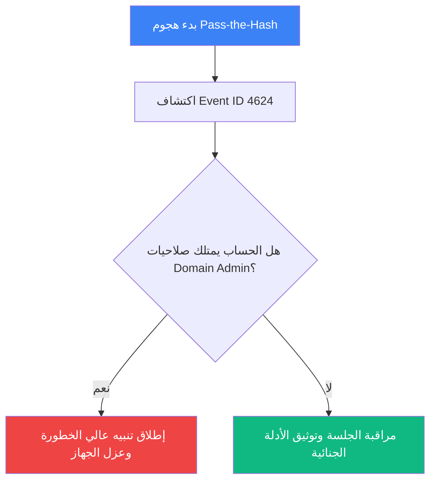

# دليل التحقيق الجنائي والاستجابة للحوادث

هذا المقال مخصص لاختبار كافة حالات النصوص العربية والإنجليزية المختلطة (Bidirectional Text) وتوافق الجداول والرموز ومخططات Mermaid.

---

## Kerberoasting وتحليل التذاكر

PowerShell هو إطار عمل قوي يعتمد عليه المهاجمون لتنفيذ أوامر الاستطلاع وحقن العمليات المشبوهة داخل الذاكرة.

أثناء فحص الذاكرة لجهاز الضحية، تبين أن الأداة المستخدمة في سرقة تذاكر الخدمة هي **Mimikatz**.

تم رصد مؤشرات خطيرة تؤكد استخدام تقنية "Pass-the-Hash" في محاولة الوصول لحسابات المجال الحساسة.

عند مراجعة سجلات الأحداث، تم تسجيل محاولات دخول فاشلة متكررة (Event ID 4625) تلتها عملية تسجيل دخول ناجحة (Event ID 4624) في وقت متأخر من الليل.

---

## كشف مسارات الملفات والمؤشرات التقنية

فيما يلي قائمة بمؤشرات الاختراق التي تم جمعها أثناء تحليل محطة العمل:

- Pass-the-Hash يعتمد على إعادة استخدام NTLM hash دون الحاجة لمعرفة كلمة المرور الأصلية.
- تم العثور على أداة مشبوهة في المسار C:\Windows\System32\cmd.exe تم استدعاؤها عبر %APPDATA%\Roaming\payload.exe بشكل غير معتاد.
- استهدفت العملية مفتاح التسجيل HKLM\SOFTWARE\Microsoft\Windows\CurrentVersion\Run لتثبيت بقاء المهاجم في النظام.
- تم تشغيل الأمر powershell -enc بواسطة المهاجم مع المعامل --help لفحص بيئة الضحية.
- تم رصد اتصال خارجي موجه إلى الخادم 192.168.1.50:8080 عبر منفذ غير قياسي.
- فحص سجلات النظام في المسار /var/log/auth.log أظهر محاولات تصعيد صلاحيات.
- نسبة اكتمال التشفير بلغت 50% قبل أن يتدخل فريق الاستجابة للحوادث.
- المتغير $env:PATH تم تعديله لإضافة مسار تنفيذي خبيث.
- ارتبطت الثغرة المستغلة بالمعرف CVE-2021-44228, وتم التحقق من استغلالها بنجاح.
- مرجع تقنية MITRE ATT&CK متاح عبر الرابط [MITRE ATT&CK T1059](https://attack.mitre.org/techniques/T1059/) لمزيد من التفاصيل.

---

## فقرة باللغة الإنجليزية داخل مقال عربي

All domain controllers and internal management servers must be patched immediately to prevent lateral movement.

> Security in depth is not a single product or feature; it is an integrated architectural strategy.

---

## جدول الأحداث والمؤشرات التقنية

| نوع الحدث | عنوان IP والمنفذ | المعرف البرمجي | مستوى الخطورة | الإجراء المتخذ |
| :--- | :--- | :--- | :--- | :--- |
| محاولة تسجيل دخول فاشلة | 10.0.0.15:445 | Event ID 4625 | متوسط | حظر مؤقت للعنوان |
| استدعاء C2 مشبوه | 192.168.1.50:8080 | T1059.001 | حرج | عزل المحطة فوراً |
| فحص سجلات المصادقة | 172.16.0.4:22 | SSH-Bruteforce | مرتفع | تجديد المفاتيح |

---

## مخطط تدفق الهجوم والاستجابة (Mermaid)



---

## أوامر الاستجابة عبر الطرفية (LTR)

الأوامر البرمجية التالية يجب أن تظل بالاتجاه الأيسر تماماً:

```powershell
# Get active network connections from compromised endpoint
Get-NetTCPConnection -State Established | Where-Object { $_.RemoteAddress -eq "192.168.1.50" }
```

```bash
# Verify process hashes against known threat intelligence
sha256sum /var/log/auth.log
```
