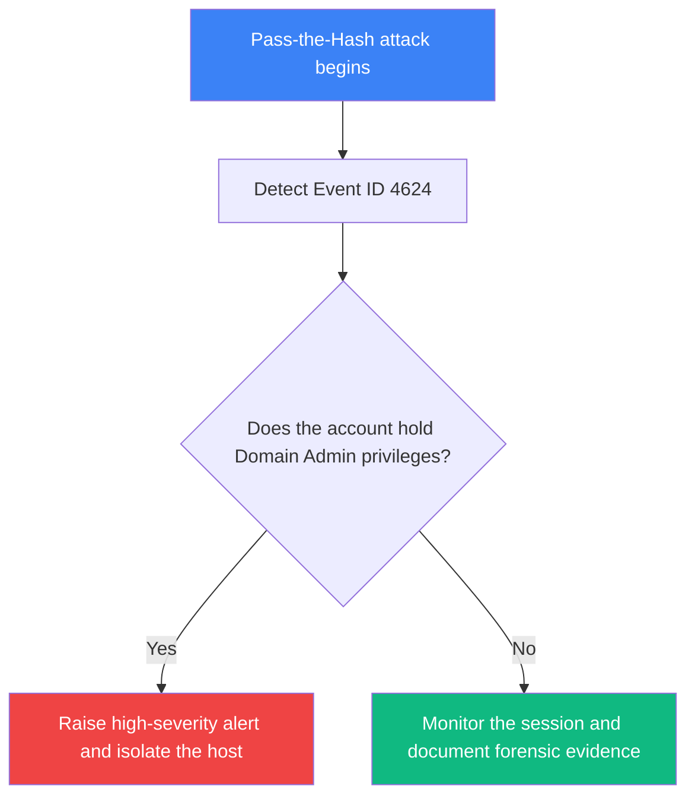

# Forensic Investigation and Incident Response Guide

This article is intended to test all cases of mixed Arabic and English text (Bidirectional Text), as well as table, symbol, and Mermaid diagram compatibility.

---

## Kerberoasting and Ticket Analysis

PowerShell is a powerful framework that attackers rely on to run reconnaissance commands and inject suspicious processes into memory.

While examining the memory of the victim's machine, it became clear that the tool used to steal service tickets was **Mimikatz**.

Serious indicators were detected confirming the use of the "Pass-the-Hash" technique in an attempt to reach sensitive domain accounts.

When reviewing the event logs, repeated failed logon attempts (Event ID 4625) were recorded, followed by a successful logon (Event ID 4624) late at night.

---

## Uncovering File Paths and Technical Indicators

The following is a list of indicators of compromise collected while analyzing the workstation:

- Pass-the-Hash relies on reusing an NTLM hash without needing to know the original password.
- A suspicious tool was found at C:\Windows\System32\cmd.exe and was unusually invoked through %APPDATA%\Roaming\payload.exe.
- The process targeted the registry key HKLM\SOFTWARE\Microsoft\Windows\CurrentVersion\Run to maintain the attacker's persistence on the system.
- The attacker ran the command powershell -enc with the --help parameter to probe the victim's environment.
- An outbound connection was observed to the server 192.168.1.50:8080 over a non-standard port.
- Inspecting the system logs at /var/log/auth.log revealed privilege escalation attempts.
- Encryption progress reached 50% before the incident response team intervened.
- The $env:PATH variable was modified to add a malicious executable path.
- The exploited vulnerability was linked to the identifier CVE-2021-44228, and successful exploitation was verified.
- The MITRE ATT&CK technique reference is available at [MITRE ATT&CK T1059](https://attack.mitre.org/techniques/T1059/) for more details.

---

## Arabic Paragraph Inside an English Article

This section is the mirror of the "English paragraph inside an Arabic article" test. The Arabic sentence below must not flip the page layout, and this article must not be detected as Arabic.

تم رصد محاولة تصيد عبر البريد الإلكتروني استهدفت موظفي قسم المالية.

The phishing (تصيد) campaign used a spoofed sender domain to impersonate the IT department.

> Security in depth is not a single product or feature; it is an integrated architectural strategy.

---

## Events and Technical Indicators Table

| Event Type | IP and Port | Identifier | Severity | Action Taken |
| :--- | :--- | :--- | :--- | :--- |
| Failed logon attempt | 10.0.0.15:445 | Event ID 4625 | Medium | Temporary IP block |
| Suspicious C2 callback | 192.168.1.50:8080 | T1059.001 | Critical | Immediate host isolation |
| Authentication log review | 172.16.0.4:22 | SSH-Bruteforce | High | Key rotation |

---

## Attack and Response Flow Diagram (Mermaid)



---

## Response Commands via the Terminal (LTR)

The following commands must remain strictly left-to-right:

```powershell
# Get active network connections from compromised endpoint
Get-NetTCPConnection -State Established | Where-Object { $_.RemoteAddress -eq "192.168.1.50" }
```

```bash
# Verify process hashes against known threat intelligence
sha256sum /var/log/auth.log
```
