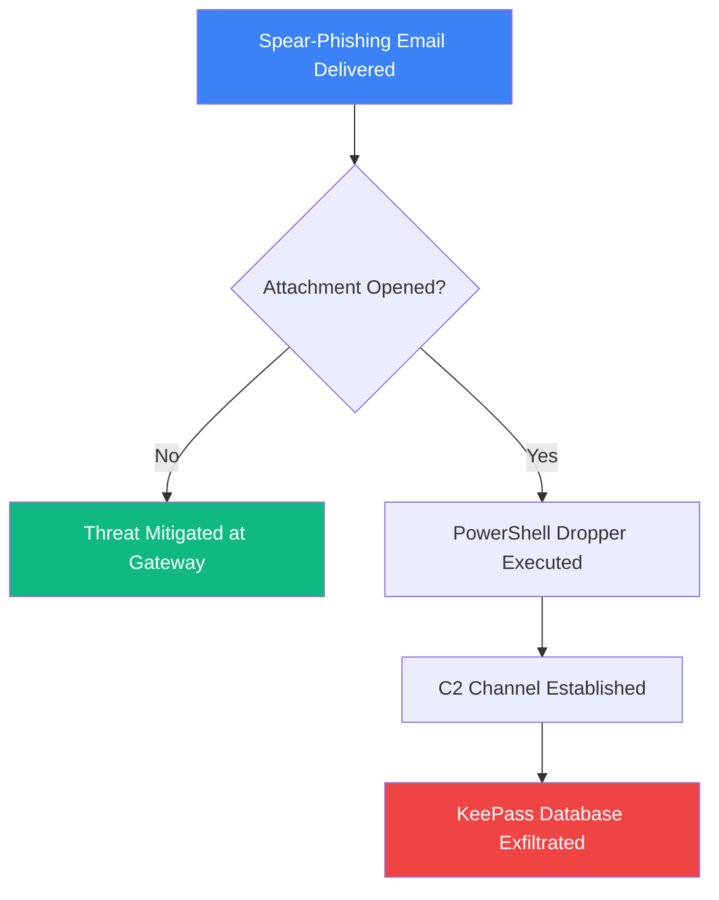
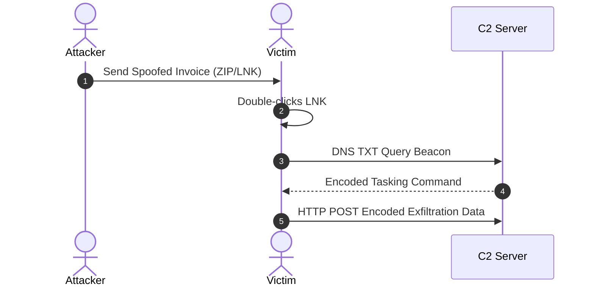

# Mermaid Diagram Test Suite

This test article verifies that fenced ````mermaid```` code blocks render into actual interactive SVG diagrams across the entire portfolio.

---

## 1. Flowchart Diagram (Incident Response Flow)



---

## 2. Sequence Diagram (Authentication & C2 Beaconing)



---

## 3. Invalid Syntax Handling (Graceful Degradation Test)

The block below contains deliberately invalid syntax. It should display a red warning message and the fallback code block, without crashing the page or breaking other diagrams.

```mermaid
graph TD
  A ---> >>> INVALID_SYNTAX_NODE ??? !!!
```

---

## 4. Normal Code Block Non-Regression Test

Normal code blocks (like Python or Bash) must remain standard syntax-highlighted code blocks with copy/read styling and must NOT attempt to render as diagrams:

```python
def verify_hash(file_path: str, expected_sha256: str) -> bool:
    import hashlib
    with open(file_path, "rb") as f:
        digest = hashlib.sha256(f.read()).hexdigest()
    return digest.lower() == expected_sha256.lower()
```

```bash
# Verify network connections
Get-NetTCPConnection -State Established | Select-Object LocalAddress, RemoteAddress, OwningProcess
```

